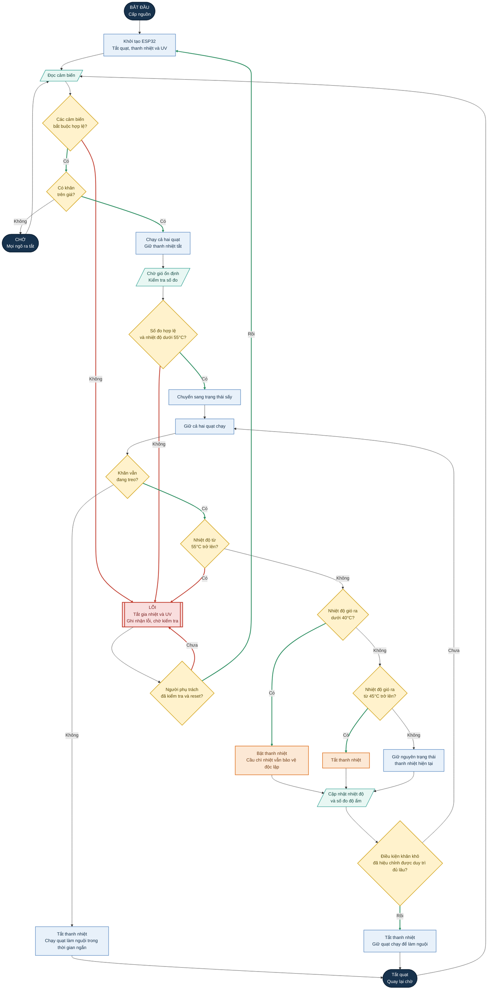

# Lưu đồ điều khiển máy sấy khăn

## Mục đích

Tài liệu này mô tả luồng điều khiển ban đầu cho ESP32: phát hiện khăn, chạy quạt, điều khiển nhiệt độ, xác định thời điểm sấy xong và xử lý lỗi. Các ngưỡng ghi **tạm thời** cần được kiểm chứng trên mô hình thực tế trước khi sử dụng chính thức.

## Tín hiệu vào và đầu ra

| Tín hiệu | Chức năng |
|---|---|
| Cảm biến TCRT5000 | Phát hiện khăn đang treo trên giá |
| Cảm biến nhiệt DS18B20 | Đo nhiệt độ gió ra để điều khiển gia nhiệt và phát hiện quá nhiệt |
| Cảm biến SHT31 trong khung | Đo nhiệt độ và độ ẩm không khí trong khung |
| Cảm biến AHT20 ngoài khung | Đo nhiệt độ và độ ẩm không khí trong phòng để so sánh |
| Ngõ ra quạt | Điều khiển hai quạt thổi qua hai ống đáy |
| Ngõ ra gia nhiệt | Bật/tắt từng thanh PTC qua MOSFET; cầu chì nhiệt phần cứng vẫn hoạt động độc lập |
| Ngõ ra UV tùy chọn | Không sử dụng trong quy trình sấy ban đầu; cần thiết kế che chắn và kiểm chứng riêng |

## Các trạng thái hoạt động

1. **KIỂM_TRA_KHỞI_ĐỘNG** — Tắt mọi ngõ ra, khởi tạo cảm biến và kiểm tra dữ liệu có hợp lý không.
2. **CHỜ** — Chờ phát hiện khăn. Quạt, thanh nhiệt và đèn UV đều tắt.
3. **KIỂM_TRA_GIÓ** — Bật quạt, giữ thanh nhiệt tắt, chờ số đo ổn định.
4. **ĐANG_SẤY** — Giữ quạt chạy, điều khiển thanh nhiệt theo giới hạn nhiệt độ và theo dõi xu hướng độ ẩm.
5. **XÁC_NHẬN_SẤY_XONG** — Khi điều kiện khô đã được hiệu chỉnh đạt yêu cầu, tắt thanh nhiệt nhưng giữ quạt chạy thêm một khoảng ngắn để đẩy khí ẩm ra ngoài, sau đó tắt quạt và quay về trạng thái chờ.
6. **LỖI** — Tắt thanh nhiệt và đèn UV ngay. Chỉ giữ quạt chạy nếu cảm biến nhiệt còn hợp lệ và việc chạy quạt an toàn; nếu không thì tắt toàn bộ ngõ ra. Giữ trạng thái lỗi cho đến khi người vận hành kiểm tra và khởi động lại.

## Lưu đồ

## Quy tắc điều khiển

### Khởi động và kiểm tra cảm biến

- Khi khởi động, tắt tất cả ngõ ra.
- Chỉ cho phép bật thanh nhiệt khi DS18B20, SHT31 và AHT20 đều trả về số đo hợp lệ.
- Xem dữ liệu mất kết nối, ngoài dải cho phép hoặc không cập nhật là lỗi. Số đo nhiệt độ không hợp lệ không được xem là điều kiện cho phép gia nhiệt.
- TCRT5000 chỉ dùng để xác định có khăn hay không. Không dùng cảm biến này làm liên động an toàn cho đèn UV-C.

### Liên động quạt và thanh nhiệt

- Cả hai quạt được yêu cầu chạy trong suốt quá trình sấy.
- Chỉ cho phép bật thanh nhiệt khi cả hai quạt đang được lệnh chạy và các cảm biến nhiệt bắt buộc hoạt động bình thường.
- Danh sách linh kiện hiện tại chưa có cảm biến tốc độ quạt hoặc công tắc xác nhận luồng gió. Vì vậy, phần mềm không thể biết quạt có thực sự quay hay không. Cầu chì nhiệt độc lập phải được mắc nối tiếp trực tiếp với nguồn thanh nhiệt. Nếu cần xác nhận luồng gió trước khi gia nhiệt, cần bổ sung cảm biến tốc độ quạt hoặc cảm biến luồng khí.

### Điều khiển nhiệt độ

- Dải nhiệt mục tiêu ban đầu: **40–45°C** tại vị trí đo gió ra đã chọn (**tạm thời**).
- Dùng độ trễ để tránh đóng/ngắt liên tục: bật thanh nhiệt khi nhiệt độ dưới 40°C; tắt khi nhiệt độ đạt từ 45°C trở lên. Trong khoảng 40–45°C, giữ nguyên trạng thái thanh nhiệt trước đó.
- Khi nhiệt độ đạt từ **55°C** trở lên, tắt cả hai thanh nhiệt ngay và chốt lỗi quá nhiệt. Không tự bật lại sau lỗi này.
- Nếu DS18B20 mất kết nối hoặc báo dữ liệu không hợp lệ, tắt thanh nhiệt và chốt lỗi cảm biến.
- Cầu chì nhiệt KSD301 phải ngắt được dòng thanh nhiệt ngay cả khi ESP32, MOSFET hoặc chương trình gặp sự cố. Cần xác nhận loại tiếp điểm, nhiệt độ tác động, dòng chịu tải, cách lắp và mức phù hợp về điện trước khi dùng.

### Xác định khăn đã khô

Hai cảm biến độ ẩm có thể giúp theo dõi xu hướng, nhưng một ngưỡng độ ẩm tương đối đơn lẻ không chứng minh khăn đã khô. Nhiệt độ trong khung và ngoài phòng có thể khác nhau, làm thay đổi độ ẩm tương đối dù lượng hơi nước trong không khí không đổi.

Với mô hình đầu tiên:

1. Ghi lại nhiệt độ và độ ẩm của cả hai cảm biến trong các lần sấy có kiểm soát.
2. So sánh đại lượng đã tính đến nhiệt độ, chẳng hạn tỷ số độ ẩm, hoặc hiệu chỉnh chênh lệch độ ẩm trong khung và ngoài phòng bằng cách cân khăn.
3. Dựa trên nhiều lần thử để chọn ngưỡng khô; yêu cầu ngưỡng đó được duy trì liên tục trong một khoảng thời gian trước khi dừng.
4. Cân khăn trước và sau khi sấy, đồng thời ghi nhận khăn có đạt tiêu chí khô đã thống nhất hay chưa.

Trước khi hiệu chỉnh xong, chưa nên khẳng định chức năng tự nhận biết khăn khô đã được kiểm chứng. Dùng bộ đếm thời gian chạy tối đa làm phương án dừng dự phòng và báo cho người vận hành kiểm tra khăn khi hết giờ. Chọn thời gian này sau các lần thử có giám sát; tài liệu chưa ấn định con số cụ thể.

### Dừng và xử lý lỗi

- Nếu khăn bị lấy ra, tắt thanh nhiệt ngay. Chỉ giữ quạt chạy làm nguội trong thời gian ngắn nếu cảm biến nhiệt hợp lệ và nhiệt độ dưới ngưỡng lỗi; sau đó tắt quạt.
- Khi có bất kỳ lỗi nào, tắt thanh nhiệt và UV ngay. Giữ lỗi cho đến khi người vận hành kiểm tra và reset.
- Đèn UV-C chưa nằm trong lưu đồ điều khiển này. Không cấp điện cho dải LED đang có nếu chưa xác minh bước sóng và tính phù hợp với UV-C. Thiết kế UV-C sau này cần che chắn độc lập và liên động để không làm lộ tia khi khăn bị lấy ra hoặc cảm biến gặp lỗi.

## Các giá trị cần hiệu chỉnh trên mô hình

| Hạng mục | Giá trị ban đầu hoặc cách xác định | Trạng thái |
|---|---|---|
| Ngưỡng bật thanh nhiệt | 40°C | Tạm thời |
| Ngưỡng tắt thanh nhiệt | 45°C | Tạm thời |
| Ngưỡng quá nhiệt của phần mềm | 55°C | Tạm thời; vẫn phải có cầu chì nhiệt phần cứng độc lập |
| Ngưỡng xác định khăn khô | Xác định từ nhật ký nhiệt độ, độ ẩm và khối lượng khăn | Chưa chốt |
| Thời gian xác nhận khăn khô | Chọn dựa trên dữ liệu thử nghiệm | Chưa chốt |
| Thời gian chạy quạt làm nguội | Chọn theo thời gian nguội đo được | Chưa chốt |
| Thời gian chạy tối đa | Chọn sau các lần thử có giám sát | Chưa chốt |

## Trình tự thử nghiệm cho phần điều khiển

1. Kiểm tra số đo cảm biến khi chưa nối thanh nhiệt.
2. Kiểm tra lệnh chạy quạt và xác nhận có luồng gió ở cả hai ống.
3. Thử thanh nhiệt có người giám sát và có bảo vệ độc lập; xác nhận dải điều khiển 40–45°C và khả năng tắt thanh nhiệt.
4. Kiểm tra các nhánh lỗi khi cảm biến mất kết nối và quá nhiệt bằng phương pháp an toàn, không cố tình tạo tình huống quá nhiệt nguy hiểm.
5. Thực hiện nhiều lần sấy khăn, ghi thời gian, nhiệt độ gió ra, nhiệt độ và độ ẩm trong/ngoài khung, cùng khối lượng khăn trước và sau khi sấy.
6. Chỉ đặt ngưỡng khô sau khi dữ liệu đo hỗ trợ lựa chọn đó.
